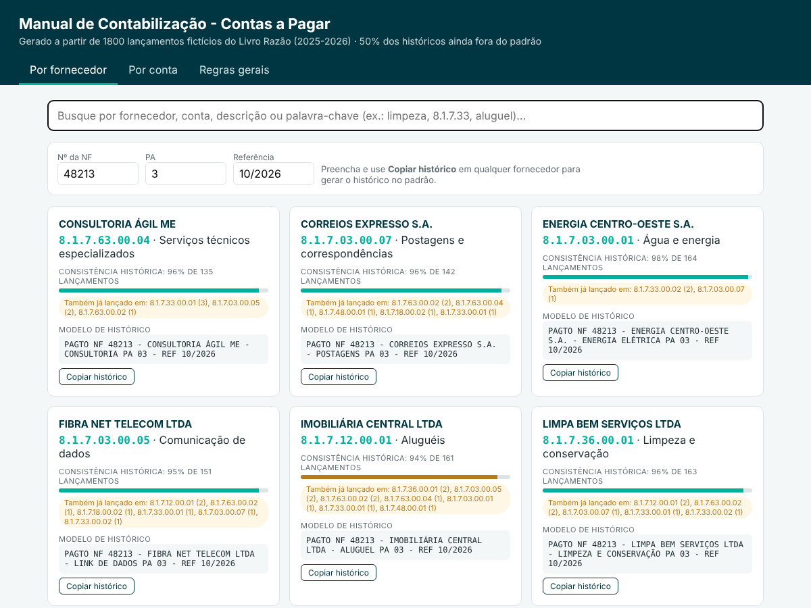

# Manual de Contabilização do Contas a Pagar

  

Manual pesquisável de **classificação contábil das despesas**, feito para a equipe de Contas a Pagar consultar no dia a dia. A diferença para um manual comum é que ele é **gerado a partir do histórico real do Livro Razão**: para cada fornecedor, mostra a conta em que ele costuma ser lançado, o **grau de consistência** dessa classificação e as contas "fora da curva" já usadas. Também traz um **gerador de histórico padronizado**.

> **Dados fictícios.** Fornecedores, contas e lançamentos são gerados por `scripts/construir_manual.py`.



## Por que existe

- A mesma despesa era classificada em contas diferentes por pessoas diferentes, o que distorcia os relatórios de despesa administrativa.
- Os históricos de lançamento não seguiam padrão, e achar um lançamento pelo número da nota era difícil. No exemplo, **50% dos históricos** estão fora do padrão.
- O manual antigo era um texto estático, desatualizado em relação à prática.

## Como funciona

```
Livro Razão (CSV) ──► construir_manual.py ──────────► data/manual.json ──► index.html
                       • identifica o fornecedor no histórico           busca sem acento,
                       • conta mais usada + % de consistência           abas por fornecedor/conta,
                       • contas alternativas já usadas                  gerador de histórico
plano_contas.json ─────► "usar quando" / "não usar para" por conta
```

- **Consistência por fornecedor**: barra verde (≥ 95%), amarela (≥ 85%) ou vermelha. Fornecedores com consistência baixa são candidatos a orientar a equipe.
- **Plano de contas comentado**: para cada conta, quando usar e, principalmente, **quando não usar** (os erros mais comuns).
- **Gerador de histórico**: preenche NF, PA e referência e copia o texto no padrão `PAGTO NF {NF} - {FORNECEDOR} - {DESCRIÇÃO} PA {PA} - REF {MM/AAAA}`.
- **Busca** sem diferenciar acentos e maiúsculas, por fornecedor, conta, descrição ou palavra-chave.

## Executar

```bash
python scripts/construir_manual.py --regerar   # gera o histórico fictício e data/manual.json
python -m http.server 8000                     # abra http://localhost:8000
pytest -q
```

Publicação: *Settings › Pages › Deploy from branch (main, /root)*. Para atualizar, troque o CSV do razão, rode o script e faça o commit do `manual.json`.

## Stack

HTML/CSS/JavaScript (sem frameworks) · Python (csv, json, collections) · pytest · GitHub Pages

---
Autor: **Gabriel Antônio Ribeiro**, Analista Financeiro · [LinkedIn](https://www.linkedin.com/in/gabriel-ant%C3%B4nio-ribeiro-017808210)
